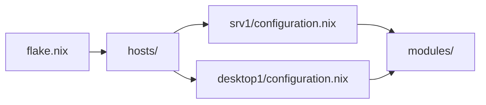

# nix-config
[](https://github.com/zzzealed/nix-config/actions/workflows/check-no-build.yml)
[](https://github.com/zzzealed/nix-config/actions/workflows/build.yml)


## Structure

> [!NOTE]
> NOT exhaustive.

## Usage
1. Clone, or download the repository:
```sh
curl -L -O https://github.com/zzzealed/nix-config/archive/refs/heads/main.tar.gz
```
2. Unzip with:
```sh
tar -xzf main.tar.gz
```
3. Enter shell: 
```sh
cd nix-config-main && nix-shell
```
4. Rebuild and switch with a host's (eg. desktop1's) configuration:
```sh
sudo nixos-rebuild switch --flake .#desktop1
```
> [!IMPORTANT]
> You need to use `nixos-generate-config` and replace [hosts/](/hosts/)*foo*/hardware-configuration.nix.

> [!IMPORTANT]
> You also need a valid SSH-key defined in [secrets/secrets.nix](/secrets/secrets.nix) to decrypt any secrets.

## To-do
- [ ] Init: `services.crowdsec` blocker: nixos/nixpkgs#535319
- [ ] Init: `sops.secrets` blocker: mic92/sops-nix#970
- [ ] Switch hosts `server`, `pi` to `boot.loader.limine`
- [ ] Make all files+dirs kebab-case
- [ ] More `pkgs.navi` docs
- [ ] `services.*`: Unique ports?
- [ ] Just rawdog dnsmasq instead of Pihole
- [ ] `home.nix` -> `hm.nix` & `<other>.hm.nix`
- [ ] services/`proxy.nix`+`monitor.nix`+`mount.nix`
- [ ] WSL: symlinks
- [ ] `secrets/`: New SSH-keys+host keys 
- [ ] `secrets/`: Consistent naming+formatting
- [ ] USB Wireguard config
- [ ] Syncthing Linux configs to Windows
- [ ] TOR-bridge @ vps1
- [ ] `rpi1`: MPD + HA
- [ ] Zigbee HA setup
- [ ] `router2` -> OpenWRT
- [ ] Bump `flake.lock`
- [ ] Init: `services.rss-bridge`
- [ ] Home-Assistant; offline/require zpool unlock?
- [ ] Init: `services.syncthing.relay`
- [ ] Update `wireguard-topology.md`
- [ ] `meta.nix`: SSH pub keys
